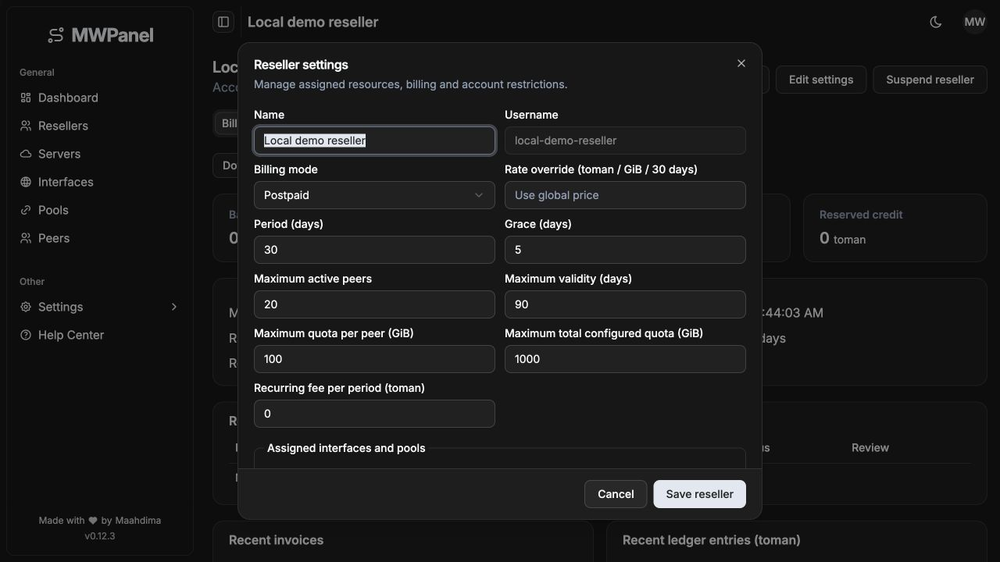

# Add reseller billing, tenant isolation and concurrent router management

MWPanel previously treated administrative users and router access as global, so one installation could not safely host resellers with independent resources and balances. This contribution adds owned peer operations, exact prepaid/postpaid accounting, manually approved card-to-card receipts and router-specific lifecycle management while retaining Echo/GORM, React/TanStack, English UI and the embedded single-binary build.

## Behavior

- Resolve current roles from the database and enforce ownership on dedicated reseller reads, mutations, exports and financial routes. Existing/imported unassigned peers remain admin-owned; public customer UUIDs remain stable.
- Centralize exact byte/rial pricing and immutable operation snapshots. Reserve prepaid credit atomically, invoice anchored postpaid periods, preserve balances/history across mode changes and prevent duplicate charges, receipt approvals and recurring fees.
- Reconcile independent manual, expiration, quota, billing and administrative restrictions to each peer's actual router. Approval clears only applicable billing restrictions.
- Persist paid/free peer operations before external changes. Verify ambiguous router outcomes and recover after database failures without unjustified finalized charges.
- Migrate reseller peers across routers through preflight, disabled destination preparation, protected counter sampling, atomic metadata switching, refreshed configs/QR codes and verified source cleanup. Support compensation before any switch and forward recovery afterward.
- Reuse existing UI components for reseller administration, billing/payment review, resource/owner filters, exact toman forms, scoped configurations and migration progress. Complete scoped financial histories are downloadable as CSV.

## Architectural alignment

Reseller transport schemas follow `http/schema`, JWT policy lives in the existing middleware package, and frontend requests run through domain API modules and named hooks. Administration reuses existing form/select/password controls; scoped configurations reuse the shared table and skeleton. See [refactor verification](reseller-management-refactor.md). Financial and router recovery algorithms retain their original semantics.

## Compatibility and migration

SQLite and PostgreSQL are supported. Additive models and composite router indexes preserve legacy records. Ambiguous legacy router ownership requires `LEGACY_ROUTER_SERVER_ID`; it is never silently assigned. Configurations/QR codes are written atomically with owner-only permissions. SQL diagnostic values are redacted. No new dependency or separate application is introduced.

Cross-router migration can change client addresses and VPN endpoints; clients may need to download updated configurations. Existing share UUIDs, ownership, accounting, usage and expiry are retained. Same-router moves between different interfaces are intentionally rejected during preflight. A legacy peer needs an explicitly recorded original duration before a full reset; that value cannot be reconstructed reliably from an already modified expiry.

## Validation

The activation/provisioning follow-up restores focused test coverage and test-only Mock RouterOS with explicit authorization. Equivalent scheduler date formats no longer block provisioning; verified paid peers activate through independent restriction reconciliation, including prepaid balances of zero. Admin-only retry resets backoff without bypassing verification or leases. The detail UI separates account, financial, provisioning and synchronization states using existing components.

Per-peer download/upload limits are available during creation and through Manage → Change speed limits. Speed changes are free, durable, idempotent, scoped to the owned peer's router and verified before local metadata is finalized. Existing prices and restrictions are preserved.

Current checks (2026-10-30): full SQLite Go suite, Go vet, embedded production binary, TypeScript/Vite build, ESLint, changed-source Prettier, 12 Node UI-state tests and diff whitespace check passed. Tests cover activation, payments, restriction preservation, retry/lease recovery, exact financial rules, speed validation, ambiguous queue updates and multi-router isolation. Earlier PostgreSQL/race results are historical; neither was rerun for this follow-up.

Browser checks covered both user-provided roles and disposable activation screens at desktop/mobile sizes in dark mode. Final speed-form visual verification could not complete because the browser transport became unavailable. No real router or production-data changes were made. The existing localhost:3000 process must load the new build before these changes appear there.

## Related issue

Implements the proposal in [#6](https://github.com/Maahdima/MWPanel/issues/6).

## UI preview

The previews use disposable local demo data.
