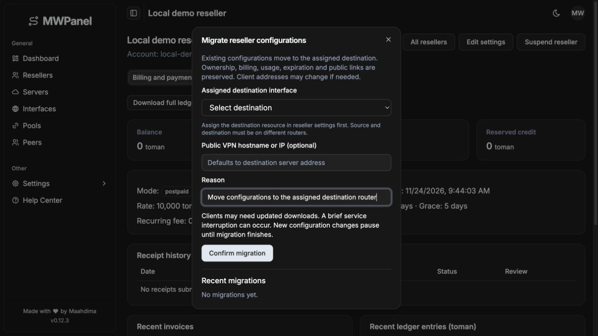

# Add reseller billing, tenant isolation and concurrent router management

MWPanel previously treated administrative users and router access as global, so one installation could not safely host resellers with independent resources and balances. This contribution adds owned peer operations, exact prepaid/postpaid accounting, manually approved card-to-card receipts and router-specific lifecycle management while retaining Echo/GORM, React/TanStack, English UI and the embedded single-binary build.

## Behavior

- Resolve current roles from the database and enforce ownership on dedicated reseller reads, mutations, exports and financial routes. Existing/imported unassigned peers remain admin-owned; public customer UUIDs remain stable.
- Centralize exact byte/rial pricing and immutable operation snapshots. Reserve prepaid credit atomically, invoice anchored postpaid periods, preserve balances/history across mode changes and prevent duplicate charges, receipt approvals and recurring fees.
- Reconcile independent manual, expiration, quota, billing and administrative restrictions to each peer's actual router. Approval clears only applicable billing restrictions.
- Persist paid/free peer operations before external changes. Verify ambiguous router outcomes and recover after database failures without unjustified finalized charges.
- Migrate reseller peers across routers through preflight, disabled destination preparation, protected counter sampling, atomic metadata switching, refreshed configs/QR codes and verified source cleanup. Support compensation before any switch and forward recovery afterward.
- Reuse existing UI components for reseller administration, billing/payment review, resource/owner filters, exact toman forms, scoped configurations and migration progress. Complete scoped financial histories are downloadable as CSV.

## Compatibility and migration

SQLite and PostgreSQL are supported. Additive models and composite router indexes preserve legacy records. Ambiguous legacy router ownership requires `LEGACY_ROUTER_SERVER_ID`; it is never silently assigned. Configurations/QR codes are written atomically with owner-only permissions. SQL diagnostic values are redacted. No new dependency or separate application is introduced.

Cross-router migration can change client addresses and VPN endpoints; clients may need to download updated configurations. Existing share UUIDs, ownership, accounting, usage and expiry are retained. Same-router moves between different interfaces are intentionally rejected during preflight. A legacy peer needs an explicitly recorded original duration before a full reset; that value cannot be reconstructed reliably from an already modified expiry.

## Validation

- Entire Go suite: `GOMAXPROCS=2 go test -p 1 -timeout 180s ./...`.
- Targeted race checks: concurrent prepaid reservations, atomic receipt approval, concurrent purchase replay and concurrent migration workers.
- Service/HTTP integration suites also executed against an isolated official PostgreSQL 17.6 container; private fixture schemas and independent pools test the same financial/router paths.
- `go vet`, UI TypeScript/Vite build, UI lint and `git diff --check`.
- Two independent Mock RouterOS servers cover colliding IDs, direct authorization bypass attempts, exact pricing, partial settlement, grace/recovery, lost-success responses, database failures after router mutation, migration resumption/compensation, source cleanup, preshared keys, queue limits, stable public downloads and consumption enforcement during migration.
- The full race suite previously passed. A later complete run with a deliberately restricted CPU budget exceeded its three-minute package timeout; normal full-suite and targeted race results are recorded separately rather than reporting that timed run as a pass.

Browser verification caught and fixed reseller navigation repeatedly calling admin APIs. The final checked login used only successful auth/billing requests. UI captures are available with the local review artifacts; no real MikroTik or production data was used.

## Related issue

Implements the proposal in [#6](https://github.com/Maahdima/MWPanel/issues/6).

## UI preview

The preview uses disposable local demo data.
